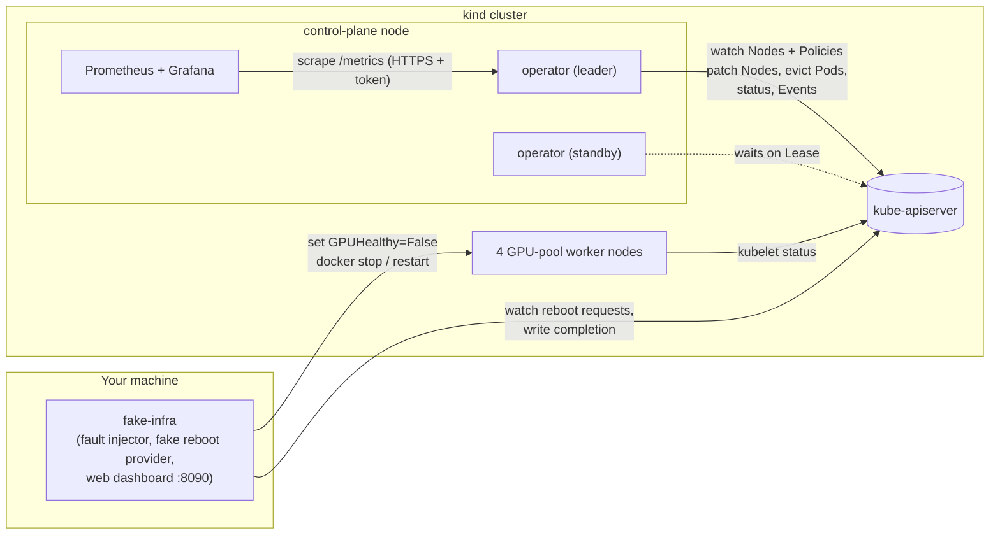
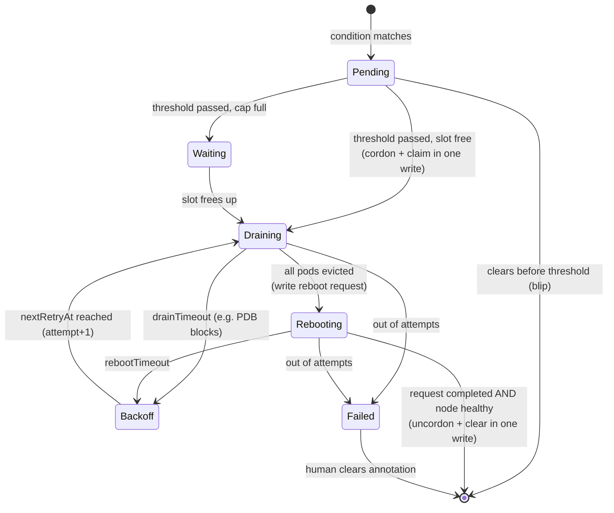

# Node Health Auto-Remediation Operator

A Kubernetes operator that finds unhealthy nodes (NotReady, GPU faults) and
repairs them automatically: **cordon → drain → reboot/replace → uncordon**. It is
built so the automation itself can't make an outage worse.

In a large GPU cluster, nodes fail all the time: kubelets hang, GPUs throw Xid
errors, disks fill up. Fixing them by hand doesn't scale. But automation that
fixes nodes is also dangerous: a bug, a network blip or a bad rollout can turn
"fix one node" into "reboot half the fleet". Most of this project is the safety
work around that.

Written in Go with kubebuilder / controller-runtime, and tested on a local kind
cluster with real faults (stopped kubelets, a `kill -9` of the leader mid-drain,
3 of 4 nodes broken at once).

| Safety rail | How |
|---|---|
| Blast-radius cap | Never more than `maxConcurrent` (count or %) nodes under remediation at once |
| Hysteresis | A condition must last `unhealthyDuration` before anything happens |
| Backoff | Failed attempts back off exponentially; after `maxAttempts` the node is left cordoned for a human |
| Crash safety | State lives on the Node; every step is idempotent; a new leader resumes mid-drain |
| Leader election | Two replicas, one active; optimistic locking guards against a stale leader |
| PodDisruptionBudgets | Drains use the Eviction API, so the API server enforces PDBs |
| Dry-run | Decides, logs and emits events, but changes nothing |

---

## Quick start (kind)

Prerequisites: Go 1.26+, Docker, kubectl, [kind](https://kind.sigs.k8s.io/).

```sh
make kind-up          # 1 control plane + 4 workers labelled nodehealth.dev/pool=gpu
make kind-deploy      # build image, load into kind, deploy operator (2 replicas)
make sample           # RemediationPolicy "gpu-pool" + a PDB-protected workload
make observability    # Prometheus (localhost:9090) + Grafana dashboard (localhost:3000)
make run-fake-infra   # fault injector + fake reboot provider + web dashboard (localhost:8090)
```

Then break something:

```sh
make break NODE=nodehealth-worker2               # GPU fault
make break NODE=nodehealth-worker3 TYPE=notready # stop the kubelet for real (docker stop)
make break NODE=nodehealth-worker4 STICKY=true   # GPU fault that a reboot won't fix
make heal  NODE=nodehealth-worker2
make watch                                       # nodes + policy status, live
kubectl get events --field-selector reason=Remediated
```

Or open **http://localhost:8090** and click "Break GPU" on a node tile.

Tests:

```sh
make test     # unit tests + envtest integration tests (real API server, no cluster needed)
make chaos    # chaos scenarios on kind (≈20 min) → docs/chaos-results.md
hack/demo.sh  # scripted demo: inject, detect, remediate (recordable with asciinema)
```

---

## Architecture



| Component | What it is |
|---|---|
| `api/v1alpha1` | The `RemediationPolicy` CRD (cluster-scoped) |
| `internal/controller` | The reconciler: observe → decide → act → record |
| `internal/remediation` | Pure decision logic (`decision.go`), node state (`state.go`), drain (`drain.go`) |
| `internal/metrics` | Prometheus metrics |
| `cmd/fake-infra` | Simulated infrastructure for kind: health exporter, reboot provider, dashboard |
| `hack/chaos` | Chaos scenarios with measured results |
| `dashboards/node-health.json` | Grafana dashboard |

### The reconcile loop

The reconcile key is a **policy**. Every reconcile:

1. **Observe:** list nodes (from cache), keep those the selector matches or this policy already owns.
2. **Decide and act, per node:**
   - owned by this policy → advance its state machine one step (below);
   - unhealthy but younger than the threshold → `Pending`, requeue when it would cross;
   - unhealthy and past the threshold → candidate.
3. **Cap:** recount active nodes *live from the API server*, then start the oldest
   candidates while slots are free. The rest are `Waiting`.
4. **Record:** policy status, gauges, and `RequeueAfter` set to the soonest time
   anything can change.

What triggers a reconcile: a policy spec change, any node change that matters
(labels, annotations, cordon, condition status), or a timer.

### Per-node state machine



`Pending` and `Waiting` are computed fresh every reconcile and appear only in
status. `Draining`, `Rebooting`, `Backoff` and `Failed` are stored on the Node in
the `remediation.nodehealth.dev/state` annotation:

```json
{"policy":"gpu-pool","phase":"Rebooting","reason":"GPUHealthy=False",
 "unhealthySince":"2026-10-20T21:04:44Z","startedAt":"2026-10-20T21:05:44Z",
 "phaseStartedAt":"2026-10-20T21:06:04Z","attempts":1,
 "requestID":"Reboot/1/1792530364","cordonedByUs":true}
```

### The policy

```yaml
apiVersion: remediation.nodehealth.dev/v1alpha1
kind: RemediationPolicy
metadata: {name: gpu-pool}
spec:
  nodeSelector: {matchLabels: {nodehealth.dev/pool: gpu}}
  unhealthyConditions:               # any match = unhealthy
    - {type: Ready, status: "False"}
    - {type: Ready, status: Unknown}
    - {type: GPUHealthy, status: "False"}
  unhealthyDuration: 60s             # hysteresis
  maxConcurrent: "25%"               # blast-radius cap (int or %)
  strategy: Reboot                   # or Replace
  drainTimeout: 2m
  rebootTimeout: 3m
  retry: {maxAttempts: 3, initialBackoff: 30s, maxBackoff: 5m}
  dryRun: false
```

```text
$ kubectl get rp
NAME       MATCHING   UNHEALTHY   REMEDIATING   MAX   DRYRUN   AGE
gpu-pool   4          3           1             1     false    20m
```

`status.nodes` lists each non-healthy node with phase, reason, attempts and a
message (for example `"1 pods left, 1 blocked by PodDisruptionBudget"`). The
`BlastRadiusLimited` condition is True while nodes are waiting on the cap.

---

## Design decisions and tradeoffs

**1. State lives on the Node, in one annotation.**
Cordoning and recording "I cordoned this" happen in one patch, so a crash can't
leave a cordoned node with no record of why. A new leader just reads the
annotation and continues. The annotation also acts as a lock between
overlapping policies. The policy status is rebuilt from the nodes each time, so
it is a view, not the source of truth.
*Tradeoff:* the operator writes to Node objects and needs RBAC for that.

**2. Every node write uses optimistic locking.**
Patches carry the `resourceVersion` we read (`MergeFromWithOptimisticLock`). If
anything changed the node since (another replica, another policy, a stale cache),
the write fails with Conflict and we reconcile again on fresh data.
*Tradeoff:* occasional harmless conflicts, because the kubelet also updates nodes.

**3. Reconcile per policy, not per node.**
The cap is a property of the whole node set, so the decision needs every node at
once. *Tradeoff:* one reconcile handles many nodes, so it must never block.
Drains are incremental (evict what you can, requeue in 5s) and each pass has a
30s timeout.

**4. The cap re-reads from the API server before handing out slots.**
The informer cache can lag our own writes by a moment. Trusting it right after
starting a remediation could undercount active nodes and start one too many.
*Tradeoff:* one uncached list of nodes, only when there are candidates.

**5. Cap rounding: percentages round down, but never below 1.**
A plain `10% of 5 = 0` would mean the operator can never fix anything in a small
pool. *Tradeoff:* in a tiny pool, 1 node can be more than the stated percentage.

**6. Failed nodes keep their slot.**
Repeated failures point to something systemic. Holding the slot stops the
automation and calls a human instead of speeding through the fleet.
*Tradeoff:* one stuck node blocks automatic repair in its pool until cleared.

**7. Hysteresis uses the condition's `lastTransitionTime`.**
Kubernetes sets it, it resets when the condition clears (so a blip restarts the
clock), and it survives controller restarts. *Tradeoff:* 1-second resolution
(see "What broke").

**8. PDBs are enforced by the API server.**
We evict, never delete. HTTP 429 means "a PDB said no": keep the pod, retry on
the next pass, and fail into backoff after `drainTimeout`. We never force it.

**9. Terminating pods on an unreachable node count as gone.**
Without a kubelet they would stay Terminating forever, which is the classic
`kubectl drain` hang. This only applies when the node's Ready condition isn't
True, after the eviction already passed PDB checks.

**10. Reboot completion is an echo of a unique request ID.**
`Reboot/<attempt>/<unix>` goes out in one annotation and must come back in another,
**and** the node must be healthy. A completion left over from an older attempt
can't be mistaken for the current one. On real hardware you'd also check that
`status.nodeInfo.bootID` changed (in kind all nodes share the host kernel, so it
doesn't).

**11. We only undo what we did.**
We uncordon only nodes we cordoned (`cordonedByUs`). If an admin had cordoned the
node first, it stays cordoned after repair.

**12. Leader election with fast handover.**
Two replicas. `LeaderElectionReleaseOnCancel` releases the Lease on clean
shutdown (about 1s handover on rollouts). A crash waits out the 15s lease. A
stale leader is covered by decision 2.

**13. The operator runs on the control plane.**
So it can never drain itself.

**14. No hot loops, no event spam.**
`RequeueAfter` is the earliest time anything can change. Status writes are
skipped when nothing changed. The policy watch ignores our own status writes
(`GenerationChangedPredicate`), and the node watch ignores heartbeat-only
updates. "Waiting", "blocked by PDB" and dry-run events fire on state changes,
not on every 5s poll.

**15. Dry-run pauses in-flight work.**
Turning dry-run on mid-remediation leaves those nodes where they are instead of
abandoning them half-drained.

**16. Policy deletion releases nodes.**
A finalizer clears our annotations and uncordons nodes that are healthy now. A
still-broken node stays cordoned, with a Warning event.

### Simulated parts (and what's real)

| | On kind | In production |
|---|---|---|
| GPU fault | `GPUHealthy` condition set by fake-infra | A GPU agent / node-problem-detector setting a condition |
| NotReady | **real**: `docker stop` on the node container | real |
| Drain, PDBs, eviction | **real** | real |
| Reboot | **real** `docker restart` of the node container | Cloud API / BMC call, checked with bootID |
| Replace | Same as reboot, but also clears "sticky" faults | New machine; Node object deleted and re-created |
| Leader election, crash | **real** (`kill -9` in the chaos test) | real |

---

## Observability

**Events** (`kubectl get events`; also shown on the web dashboard) for every
decision: `Detected`, `Cordoned`, `RebootRequested`, `DrainBlockedByPDB`,
`AttemptFailed`, `Retrying`, `Remediated`, `RemediationFailed`,
`BlastRadiusLimited`, `DryRun`, `Released`.

**Prometheus metrics:**

| Metric | Type | Meaning |
|---|---|---|
| `nodehealth_detection_seconds` | histogram | Condition change → controller first sees it |
| `nodehealth_time_to_remediate_seconds` | histogram | Condition change → node healthy and uncordoned (end to end) |
| `nodehealth_remediations_total{result}` | counter | `started`, `succeeded`, `failed` (gave up) |
| `nodehealth_remediation_attempt_failures_total{reason}` | counter | `drain_timeout`, `reboot_timeout` |
| `nodehealth_nodes_under_remediation` | gauge | Nodes using the cap |
| `nodehealth_blast_radius_limit` | gauge | Cap resolved to a node count |
| `nodehealth_unhealthy_nodes` | gauge | Matching nodes with a bad condition |

All metrics carry a `policy` label. Grafana (`make observability`, then
localhost:3000) shows nodes under remediation against the cap, cap utilization,
time-to-detect and time-to-remediate p50/p95, outcomes, and failures by reason.

**Structured logs** carry `policy` and `node` on every line:

```text
INFO  Detected unhealthy node  {"policy": "gpu-pool", "node": "nodehealth-worker2", "reason": "GPUHealthy=False", "detectionLatency": "261ms"}
INFO  Started remediation: cordoned node  {"policy": "gpu-pool", "node": "nodehealth-worker2", "reason": "GPUHealthy=False"}
INFO  Remediation succeeded  {"policy": "gpu-pool", "node": "nodehealth-worker2", "timeToRemediate": "1m23s", "attempts": 1}
```

---

## Testing

| Layer | Where | What |
|---|---|---|
| Unit | `internal/remediation/decision_test.go` | Health evaluation, threshold edges, cap rounding, backoff growth and ceiling, selection order |
| Integration (envtest) | `internal/controller/remediationpolicy_controller_test.go` | Real API server + etcd with the real controller: hysteresis, full happy path, cap, PDB blocking → backoff, backoff → Failed, crash resume, admin cordon kept, dry-run, policy deletion |
| Chaos (kind) | `hack/chaos/` | Real faults on a real cluster, with measured timings |

### Chaos results

Full output: [docs/chaos-results.md](docs/chaos-results.md).

All 6 scenarios pass (run 2). Times are seconds after the fault was injected,
taken from the operator's own events.

| Scenario | Result |
|---|---|
| 1. GPU fault (3 trials) | Detected at once; cordoned at 59.4–60.0s (threshold 60s); **back in service at 87–89s** |
| 2. 20s blip | Detected, **never acted on** |
| 3. Kubelet stopped (real NotReady) | Kubernetes marked it Unknown at 48s; cordoned at 108s; **back in service at 116s** |
| 4. 3 of 4 nodes broken at once, cap 1 | **Never more than 1** under remediation (103 samples); fixed one after another at 89s / 117s / 145s |
| 5. Leader `kill -9` mid-drain | New leader in **17s** (lease expiry); node finished at 102s with **exactly 1 reboot request**, still attempt 1 |
| 6. Fault a reboot can't fix | Retry exactly 10s after the failure; gave up after 2 attempts; node left cordoned; a second broken node **Waiting** behind it |

In scenario 5, the lease was won by a new process in the restarted container of the
killed pod (it raced the standby replica and won). Either way, a fresh process
with no memory resumed purely from the state on the Node.

### What broke during testing

- **Eviction ignored my PDB.** My first PDB test passed the pod straight
  through. The test pod had no status, so it counted as *Pending*, and the
  Eviction API only enforces PDBs on running pods. Correct Kubernetes behavior,
  wrong test; fixed by marking the pod Running and Ready.
- **A drain pass hung forever.** In envtest there is no disruption controller,
  so the PDB's status was never filled in and the eviction call just hung,
  freezing the controller's only worker. Real clusters always have that
  controller, but one stuck API call shouldn't freeze everything, so each drain
  pass now has a 30s timeout.
- **Status writes failed with Conflict.** The cached policy was one version
  behind our own previous status write. The controller is the only writer of
  status, so it now sends a patch without a version lock.
- **A "2-second reboot".** The fake reboot provider accepted a kubelet heartbeat
  sent *just before* the container went down as proof that the node had come back.
  It now requires a heartbeat sent after the restart finished.
- **Cordoned at 59.5s with a 60s threshold.** Condition timestamps have 1-second
  resolution, so the fault's start is rounded down. The threshold is accurate
  to ±1s. That's fine for a minute-scale threshold, but worth knowing; the
  chaos check allows 1s of slack.
- **A dead node deadlocked its own drain (chaos run 1, scenario 3).** When the
  kubelet stops, Kubernetes marks that node's pods NotReady. The PDB then counts
  them as already disrupted, and with the default
  `unhealthyPodEvictionPolicy: IfHealthyBudget` the API server refuses to evict
  even those dead pods. The operator did what it should: it respected the PDB,
  timed out the drain and backed off. But the node only got fixed about 5
  minutes later, when Kubernetes' own taint-based eviction removed the pods.
  The fix belongs on the workload: `unhealthyPodEvictionPolicy: AlwaysAllow`
  (now in `hack/sample-workload.yaml`). The operator still never bypasses a
  PDB, but its `DrainBlockedByPDB` event now points at this setting when the
  node isn't Ready.
- **The reboot provider and the cluster disagreed about the time (run 1,
  scenario 4).** fake-infra waited for a kubelet heartbeat "newer than now",
  using the Mac's clock. Heartbeats are stamped by the Docker VM's clock, which
  ran behind. Reboots looked like they never finished, and the operator timed
  out → backed off → retried, as designed. When fake-infra eventually answered
  an *old* request, the operator ignored it because the request ID didn't match.
  That is exactly what the unique request ID is for. Fixed by waiting for a
  heartbeat newer than the node's own pre-restart heartbeat, so no clocks from
  two machines are compared.
- **The whole cluster froze for 5 minutes (run 1).** The Docker VM paused,
  probably because the laptop slept, and its clock jumped when it resumed.
  Nothing broke, but it showed a real limitation: the hysteresis threshold
  compares a timestamp written by *another machine* (kubelet, GPU agent) with
  the controller's clock. Clock skew moves the threshold by the same amount.
  Production clusters run NTP; the alternative ("time since *I* first saw it")
  wouldn't survive controller restarts.

Run 1 (before these fixes) passed scenarios 2, 5 and 6 and failed 1, 3 and 4.
Run 2, after the fixes, is the one in [docs/chaos-results.md](docs/chaos-results.md).

### Limitations and next steps

- **No global circuit breaker.** The cap limits how many nodes are worked on at
  once, not how many are eventually touched. If 80% of nodes go NotReady at once,
  it's probably the network, and the operator should stop entirely.
- **One strategy per policy.** A real system would escalate: Reboot → Reimage → Replace.
- **Replace keeps the Node object.** Real replacement deletes it and a new node
  joins, which would need its own handling.
- **Overlapping policies** are made safe by the per-node claim, but not
  rejected. A validating webhook should reject them.
- **One threshold per policy**, not per condition.
- **On startup**, kind nodes are NotReady for about 30s. Apply policies after the
  cluster settles, or start in dry-run.

---

## Repo layout

```text
api/v1alpha1/                  RemediationPolicy types (CRD source)
cmd/main.go                    operator entry point (manager, leader election, metrics)
cmd/fake-infra/                simulated infrastructure + web dashboard (web/index.html)
internal/controller/           reconciler + envtest integration tests
internal/remediation/          decision logic (+ unit tests), node state, drain
internal/metrics/              Prometheus metrics
config/                        kustomize manifests (CRD, RBAC, manager, samples)
dashboards/node-health.json    Grafana dashboard
hack/kind-config.yaml          5-node kind cluster
hack/observability/            Prometheus + Grafana for kind
hack/chaos/                    chaos scenarios (make chaos)
hack/demo.sh                   scripted demo
docs/chaos-results.md          measured results
docs/interview-questions.md    design Q&A
```

`make help` lists every target.
